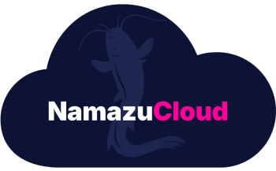

<p align="center">
  <a href="https://cloud.namazustudios.com"></a>
</p>

# namazu-cloud-addon-organization-ecr-repository

Per-organization **ECR repository** as a shared addon, in Namazu's shared
hosting AWS account (`308044622771`) — where tenant isolation does NOT come
from account boundaries, so this addon carries ownership explicitly.

One repo = one addon = one Terraform root. Inert by design: no CI, no
bootstrap — an org fork executes this root under **its** executor role at a
pinned ref. `repository_name` is deliberately default-less: **the consuming
fork's matrix entry IS the request and the config** (the runner's
`contract` input).

## What it creates (per install)

- **ECR repo** `<organization-id>/<repository-name>` (the org's database
  unique id as the prefix), `IMMUTABLE` (digest-pin workflow carries over
  1:1), scan-on-push, AES256 (not KMS — keeps the node-role IAM story
  unchanged), lifecycle: keep last 20 tagged / expire untagged after 14d.
  Tagged `ManagedBy` (+ product sku when present) for shared-account audit.
- **Per-namespace pull enforcement** (decided 2026-11-12): the repository
  policy grants pull ONLY to the installing tenant's principals — the node
  role (bound from `$instance.karpenter_node_role_name`) plus any named
  extra readers (e.g. the namespace's IRSA roles via
  `extra_reader_role_arns`).
- **CI push wiring**: one IAM role per input GitHub repository, trusted via
  GitHub OIDC **pinned to main only** (`repo:<owner>/<name>:ref:refs/heads/main`),
  permissions scoped to THIS repo's ARN. The consuming fork's bootstrap
  mints the GitHub OIDC provider (or pass `github_oidc_provider_arn`).

## Inputs

| Input | Source | Notes |
|---|---|---|
| `karpenter_node_role_name` | `$instance.karpenter_node_role_name` | the per-namespace pull principal (generic platform fact) |
| `repository_name` | fork `contract` | the tail after `<organization-id>/`; default-less |
| `github_repositories` | fork `contract` | `["owner/name", ...]` — one push role each |
| `extra_reader_role_arns` | fork `contract` | additional pull principals |
| `github_oidc_provider_arn` | fork `contract` | optional; else looked up by URL |

## Multiple repos per org (variant)

One entry per repository, each independently sweepable:

```yaml
- { addon: ".../namazu-cloud-addon-organization-ecr-repository", ref: "<pin>",
    variant: acestep-runner, instance: "<id>",
    contract: |-
      repository_name=acestep-runner
      github_repositories=["NamazuStudios/fake-the-music-server"] }
```

## What the consuming org fork needs

`iam.policy.json` (feature grants): `ecr:CreateRepository/DescribeRepositories/
DeleteRepository/PutLifecyclePolicy/GetLifecyclePolicy/SetRepositoryPolicy/
GetRepositoryPolicy/DeleteRepositoryPolicy/TagResource/ListTagsForResource`
scoped to `arn:aws:ecr:us-east-1:*:repository/<organization-id>/*` (ECR is
regional; the org id IS the name boundary in the shared account); push-role
management (`iam:CreateRole/DeleteRole/TagRole/UntagRole/PutRolePolicy/
GetRolePolicy/DeleteRolePolicy/GetRole`) scoped to
`arn:aws:iam::*:role/addon-ecr-push-<organization-id>-*` (IAM ARNs are
global, so the org id in the NAME is the qualifier; role names hash the
repository/pair to stay under IAM's 64-char limit — readability lives in
the role tags); `iam:GetOpenIDConnectProvider` on the GitHub OIDC
provider. No Kubernetes RBAC — this addon is AWS-only.

**Sweep safety:** sweep destroys from state — deleting a repository that
still holds images requires the executor to hold `ecr:DeleteRepository`
on it (granted here, org-scoped). Before removing an entry, confirm the
repo's digests are migrated or re-pinned; deletion is unrecoverable.

## Outputs

`$addon.organization-ecr-repository.<variant>.{repository_uri, registry,
repository_arn, push_role_arns}`.

## License

MIT — see [LICENSE](LICENSE).

## License & provenance

**AGPL-3.0** — see [LICENSE](LICENSE).

Part of the [Namazu Cloud Addon system](https://github.com/NamazuStudios/namazu-cloud-addon).

This is an **official [Namazu Cloud](https://cloud.namazustudios.com) addon** — it can be activated for a
**fixed fee** (the activation + review process is documented in the
[namazu-cloud-addon-example template's ADDONS.md](https://github.com/NamazuStudios/namazu-cloud-addon/blob/main/ADDONS.md)).

The repository is made public for **transparency and visibility**: it is
deeply connected to [Namazu Cloud](https://cloud.namazustudios.com) — the org-namespaced repository scheme,
the per-namespace pull boundary, and the CI push roles here are the
platform's tenant-registry story. It is written for Namazu Studios and
[Namazu Cloud](https://cloud.namazustudios.com) use; derivative works are expected to come back upstream to
`NamazuStudios`, no exceptions.

## AGPL waiver for delivered work

Namazu Studios, as the copyright holder, **waives all AGPL obligations for
software installed through a purchase or other business arrangement
between Namazu Studios and the client.** The AGPL terms above govern the
code as published in this repository; work delivered to you under
contract — including any official addon activated for a fee or custom
addon authored for you — is delivered under that agreement, not under the
license's reciprocity terms.

## Built for generative AI image pipelines

A GenAI worker image is big: CUDA base layers plus the model runtime
routinely land at 5-8 GB, and Karpenter provisions fresh GPU nodes on
every burst — every one of those nodes pulls the image.

- **In-region pulls**: the repository lives in the same account/region as
  the cluster, so cold nodes stop crawling cross-registry over the
  internet; minutes of per-node pull time become seconds-to-minutes.
- **IMMUTABLE + digest pinning = reproducible AI** — every replica of a
  generation job pulls the exact digest you tested; a re-push can never
  silently change a running model server.
- **CI push roles, main only** — the training/packaging pipeline pushes
  new model-server builds through an OIDC-trusted role scoped to this
  repo's ARN; nothing else can write your inference images.
- **Co-locate with the fast-storage + gpu addons** — pinned image
  (this repo) + provisioned weights volume (fast-storage-class) +
  dedicated GPU pool (gpu) is the full per-tenant GenAI serving stack.
<p align="center">
  <a href="https://cloud.namazustudios.com">
    <picture>
      <source media="(prefers-color-scheme: dark)" srcset="aws-partner-dark.png">
      
    </picture>
  </a>
</p>
